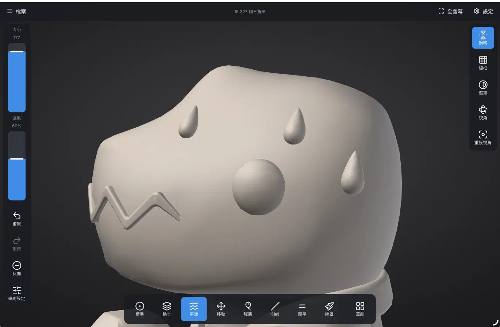

# SculptureABC

平板用的數位雕刻網頁 App（iPad／Android，繁體中文介面）。C++ 用 Emscripten 編成 WebAssembly，繪圖走 WebGL2；
同一份程式也能編成 Windows 版。

A digital sculpting web app for tablets (iPad / Android) with a Traditional Chinese interface: C++ compiled to
WebAssembly with Emscripten, drawn with WebGL2. The same code also builds for Windows.

<p align="center">
  
</p>

## 來源與授權 · Credits and license

SculptureABC 以 [SculptForge](https://github.com/islandmed/SculptForge)（GPL-3.0-or-later）為基礎：
雕刻核心（`src/core`）、繪圖（`src/render`）、匯入匯出（`src/io`）都是 SculptForge 的程式。
平板版的外殼、觸控介面與網頁殼在 `mobile/`。SculptForge 原本的說明見 [README.SculptForge.md](README.SculptForge.md)。

整個專案以 **GPL-3.0-or-later** 授權（見 [LICENSE](LICENSE)）；隨附的字型、圖示與範例模型照
[THIRD_PARTY_NOTICES.md](THIRD_PARTY_NOTICES.md) 標示來源。

SculptForge 的貢獻指南、路線圖、版本紀錄等請看 [SculptForge 的 GitHub](https://github.com/islandmed/SculptForge)
（這裡沒有附，README.SculptForge.md 裡指向它們的連結請到那邊看）。

SculptureABC is built on SculptForge and is licensed under GPL-3.0-or-later. Upstream's own read-me is
[README.SculptForge.md](README.SculptForge.md); its contributing guide, roadmap and change log are on
[SculptForge's GitHub](https://github.com/islandmed/SculptForge).

## 編譯 · Building

需要 Windows、Visual Studio 2026（附 CMake 4.3 與 Ninja）；網頁版另外需要 [Emscripten](https://emscripten.org/)（emsdk）。

```powershell
mobile\tools\build-win.ps1             # Windows → build\mobile-win\Release\SculptureABC.exe
mobile\tools\build-web.ps1             # 網頁版（單執行緒）→ build\mobile-web\
mobile\tools\build-web.ps1 -Threads    # 網頁版（多執行緒，需要 COOP/COEP 標頭）→ build\mobile-web-mt\
python mobile\tools\serve.py --https   # 區網測試伺服器（iPad 要用 https）
```

CMake 的入口是 `mobile/CMakeLists.txt`（根目錄的 `CMakeLists.txt` 是 SculptForge 桌面版的）。
